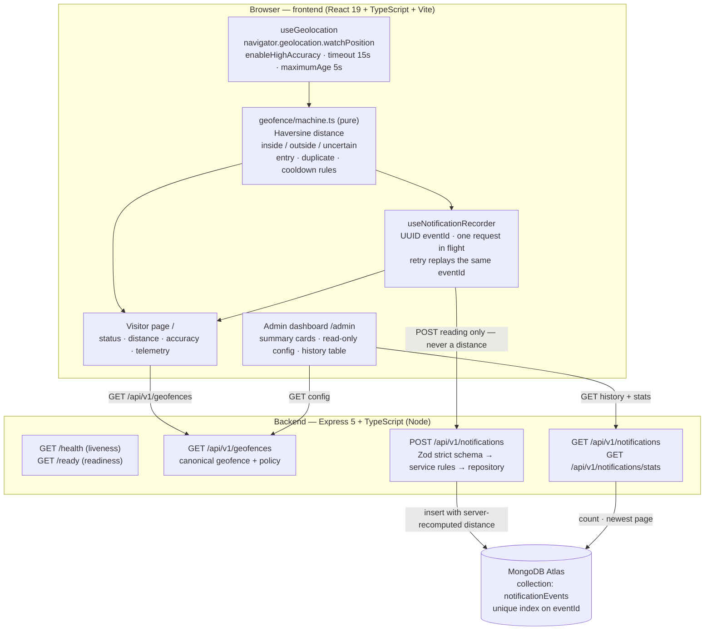

# GPS-Based Geofence Notification Web Application

A full-stack web application that streams a visitor's **real browser GPS position**, classifies it
against one fixed geofence (`inside` / `outside` / `uncertain`), records a notification the moment the
visitor is **confirmed to have entered**, persists it to MongoDB Atlas, and presents the stored
history on a read-only admin dashboard.

Proximity is never decided in the browser and trusted. The frontend classifies readings for the UI,
and the backend **re-validates everything** — coordinates, accuracy, distance, timestamp and geofence
membership — before a document is written.

- `frontend/` — React 19 + TypeScript + Vite (visitor tracking page, admin dashboard)
- `backend/` — Node.js + Express 5 + TypeScript + Mongoose + Zod (persistent REST API, Vitest)
- Database — MongoDB Atlas. There is deliberately **no local MongoDB fallback**: the server refuses to
  start if Atlas is unreachable.

---

## 1. Overview and key features

**Visitor side (`/`)**

- Wraps `navigator.geolocation.watchPosition` with `enableHighAccuracy: true`, `timeout: 15000` and
  `maximumAge: 5000`, so the browser cannot serve a stale cached fix.
- Releases the watcher with `clearWatch` on stop, on unmount and on `pagehide`, so watchers never leak
  or double up.
- Evaluates every reading with a pure, unit-testable state machine and shows the classification, the
  measured distance, the reported accuracy and the reason a notification was or was not sent.
- Records an entry through `POST /api/v1/notifications` and reports success **only after the API has
  accepted the event**; a rejection surfaces the real backend error message.
- Displays an explicit warning when the page is not in a secure context (browsers only grant
  geolocation over HTTPS or on `localhost`).

**Admin side (`/admin`)**

- Read-only summary cards (total recorded notifications, latest notification time) computed by the
  backend from the database, not from client state.
- Read-only geofence configuration panel, with an on-screen statement that the API exposes no write
  endpoints for it.
- Recent notification history, newest first: observation time, geofence id, distance and reported
  accuracy, session id, reported position and target position.
- Loading skeletons, "last refreshed" timestamp, manual refresh, and error states that never blank
  existing data.

**Persistence and safety**

- Client-generated UUID `eventId` used as the idempotency key, plus a **unique index** on `eventId`, so
  a retried submission can never create a second document.
- Strict Zod contracts on every request: the notification body rejects unknown keys, and query
  parameters are coerced and range-checked, so a client cannot supply an authoritative distance,
  radius or target coordinate.
- Centralised JSON error envelope; database internals, driver messages and stack traces never reach the
  client.
- Versioned API prefix (`/api/v1`), liveness (`/health`) and readiness (`/ready`) probes, and graceful
  shutdown on `SIGTERM`/`SIGINT`.

---

## 2. Deployed links

> **These are placeholders.** No environment has been deployed from this repository, and no URL is
> claimed. Replace each placeholder after you deploy, and delete this note.

| Deliverable | URL |
| --- | --- |
| Deployed frontend | `<https://your-frontend-host>` *(placeholder — not deployed)* |
| Deployed backend API | `<https://your-backend-host>` *(placeholder — not deployed)* |
| Demo video | `<https://your-demo-video-link>` *(placeholder — not recorded)* |
| Repository | `<https://your-git-remote>` *(placeholder)* |

---

## 3. Architecture



**Why the split works this way**

- The frontend never sends a distance, radius or target coordinate: it sends the raw reading, and the
  backend recomputes the distance from its own canonical geofence configuration.
- `backend/src/app.ts` is a listener-free, database-free app factory, so HTTP behaviour is testable
  without Atlas; `backend/src/server.ts` owns the process lifecycle (connect first, then listen).
- Both sides run the same rules independently (distance, accuracy, cooldown, 30 s reading age) so the
  visitor sees the classification the server will compute.

---

## 4. Technology stack

| Layer | Technology |
| --- | --- |
| Frontend | React 19, TypeScript, Vite 8, React Router 7, lucide-react icons, plain CSS |
| Frontend tests | Vitest 5 with jsdom, `@testing-library/react`, `@testing-library/user-event` |
| Backend | Node.js, Express 5, TypeScript, Mongoose 9, Zod 4, Helmet, CORS, dotenv |
| Backend tests | Vitest 5, Supertest 7 (in-memory repository fakes; no database) |
| Database | MongoDB Atlas (MongoDB driver via Mongoose) |
| Tooling | ESLint 10 (frontend), `tsc` project builds, `tsx` watch-mode dev server |

> **Build note.** `typescript`, `@types/node`, `@types/express` and `@types/cors` are declared as
> **production** `dependencies` in `backend/package.json`. Render installs with
> `NODE_ENV=production`, which makes npm omit `devDependencies` — including the compiler itself — so a
> `devDependencies` entry for `tsc` or for type declarations would break `npm run build` on the host.
> `vitest`, `tsx`, `supertest` and `@types/supertest` stay in `devDependencies` because neither
> `npm run build` nor `npm start` needs them.

---

## 5. Repository structure

```
geofence-notification/
├── README.md                     # this file
├── .gitignore                    # repo-wide ignores (.env, dist, node_modules, logs)
├── backend/
│   ├── package.json              # scripts: test, dev, build, typecheck, start, test:watch
│   ├── tsconfig.json             # strict: true
│   ├── tsconfig.build.json       # extends tsconfig.json, excludes src/**/*.test.ts and src/testing
│   ├── .env.example              # committed template (PORT, NODE_ENV, MONGODB_URI, FRONTEND_URL)
│   └── src/
│       ├── app.ts                # Express app factory: Helmet, CORS, JSON limit, /health, /ready, error handler
│       ├── server.ts             # process entry: connect to Atlas, then listen; SIGTERM/SIGINT shutdown
│       ├── config/
│       │   ├── env.ts            # Zod-validated environment
│       │   └── geofence.ts       # single source of truth for the demo geofence and policy
│       ├── routes/               # index.ts (/api/v1), geofences.ts, notifications.ts
│       ├── controllers/          # thin controllers; errors go to the central handler
│       ├── schemas/              # Zod request contracts + parseWithSchema
│       ├── services/
│       │   ├── geofenceService.ts        # backend evaluation state machine
│       │   ├── notificationService.ts    # validation rules + idempotency
│       │   └── notificationRepository.ts # Mongoose adapter behind an interface
│       ├── models/NotificationEvent.ts   # Mongoose schema, unique eventId index
│       ├── db/mongoose.ts        # connection lifecycle, host-only logging, 5 s server selection
│       ├── utils/                # distance.ts (Haversine), errors.ts, validation.ts
│       └── testing/              # in-memory repository fake used by tests
└── frontend/
    ├── package.json              # scripts: dev, build, preview, lint, test
    ├── vite.config.ts            # React plugin + Vitest (jsdom) configuration
    ├── .env.example              # committed template (VITE_API_BASE_URL)
    └── src/
        ├── main.tsx, App.tsx     # entry point and route table (/, /admin, fallback → /)
        ├── api/                  # client.ts, contract.ts (response parsing), geofences, notifications, failures
        ├── geofence/             # machine.ts, distance.ts, payload.ts, session.ts, status.ts
        ├── hooks/                # useGeolocation, useVisitorTracking, useNotificationRecorder,
        │                         # useGeofenceConfig, useAdminDashboard
        ├── components/           # AppShell, StatusIndicator, AccuracyNotice, TelemetryPanel,
        │                         # NotificationPanel, GeofenceInfoPanel, SummaryCards, NotificationHistoryTable
        ├── dev/                  # development-only GPS test panel and its reading builders
        └── pages/                # VisitorTrackingPage, AdminDashboardPage
```

---

## 6. Local setup

Requires **Node.js >= 22** (see `engines` in `backend/package.json`) and npm. The two halves are
separate projects with separate installs and run in two terminals.

### 6.1 Backend

```bash
cd backend
npm install
cp .env.example .env        # Windows PowerShell: Copy-Item .env.example .env
```

Open `backend/.env` and set `MONGODB_URI` to your own Atlas connection string. Everything else has a
working default. Then:

```bash
npm run dev                 # tsx watch src/server.ts → http://localhost:3000
```

| Command | Purpose |
| --- | --- |
| `npm run dev` | Watch-mode development server (`tsx watch src/server.ts`) |
| `npm run build` | Type-check and emit production JS to `dist/` (`tsc -p tsconfig.build.json`) |
| `npm start` | Run the built server (`node dist/server.js`) |
| `npm test` | Run the Vitest suite once |
| `npm run test:watch` | Vitest in watch mode |
| `npm run typecheck` | Type-check without emitting |

Quick check that it is up:

```bash
curl http://localhost:3000/health    # {"status":"ok","message":"Geofence API is running"}
curl http://localhost:3000/ready     # 200 only once Atlas is connected, otherwise 503
```

The process **exits with code 1** if `MONGODB_URI` is missing or Atlas is unreachable; it never falls
back to a local database. `/health` answers as soon as the process is up, while `/ready` stays `503`
(`DATABASE_UNAVAILABLE`) until Mongoose reports `connected`.

### 6.2 Frontend

```bash
cd frontend
npm install
cp .env.example .env        # optional; only needed if the API is not on localhost:3000
npm run dev                 # Vite dev server → http://localhost:5173
```

Open `http://localhost:5173` for the visitor page and `http://localhost:5173/admin` for the dashboard.

| Command | Purpose |
| --- | --- |
| `npm run dev` | Vite dev server (also enables the development simulation mode) |
| `npm run build` | `tsc -b && vite build` → static bundle in `dist/` |
| `npm run preview` | Serve the built bundle locally |
| `npm run lint` | ESLint over the project |
| `npm test` | Vitest suite once (jsdom) |

The backend's default CORS origin is `http://localhost:5173`, which is Vite's default port, so the two
work together out of the box.

---

## 7. Environment variables

Only `.env.example` templates are committed. Every real `.env` file is git-ignored
(`.gitignore`, `backend/.gitignore`, `frontend/.gitignore`) and must never be committed.

### 7.1 `backend/.env` (template: `backend/.env.example`)

| Variable | Default | Notes |
| --- | --- | --- |
| `PORT` | `3000` | HTTP port. Validated as an integer in `0`–`65535`. |
| `NODE_ENV` | `development` | One of `development` \| `test` \| `production`. |
| `MONGODB_URI` | *(none)* | **Required to start.** Must begin with `mongodb://` or `mongodb+srv://`. No local fallback. |
| `FRONTEND_URL` | `http://localhost:5173` | The **single** origin allowed by CORS. Must begin with `http://` or `https://`. |

All four are parsed with Zod in `backend/src/config/env.ts`, and validation messages never echo the
offending value, because it may contain credentials. Connection attempts are bounded by
`serverSelectionTimeoutMS = 5000` and logs contain the **host only** — user, password, database name
and query parameters are stripped.

### 7.2 `frontend/.env` (template: `frontend/.env.example`)

| Variable | Default | Notes |
| --- | --- | --- |
| `VITE_API_BASE_URL` | `http://localhost:3000` | API origin — no trailing slash, no `/api/v1` suffix (the app appends it). |

Vite inlines every `VITE_`-prefixed value into the browser bundle, so **anything in this file is public
by definition**. Never put `MONGODB_URI`, a database credential or any other secret here.

---

## 8. API reference

The resource endpoints are mounted under the versioned prefix `/api/v1`; the two probes
(`/health`, `/ready`) live at the server root. Every response uses one of two envelopes:

```jsonc
// success
{ "status": "ok", "message": "…", "data": { } }
// error
{ "status": "error", "error": { "code": "VALIDATION_ERROR", "message": "…" } }
```

| Method | Path | Purpose |
| --- | --- | --- |
| `GET` | `/health` | Liveness. Always `200` while the process is running. Not under `/api/v1`. |
| `GET` | `/ready` | Readiness. `200` with `data.database = "connected"` only when Mongoose is connected; otherwise `503` `DATABASE_UNAVAILABLE`. Not under `/api/v1`. |
| `GET` | `/api/v1/geofences` | The canonical geofence: `id`, `name`, `latitude`, `longitude`, `radiusMeters`, `enabled`, `policy`. Read-only: there is no create/update/delete API by design. |
| `POST` | `/api/v1/notifications` | Validate and persist one notification event. |
| `GET` | `/api/v1/notifications` | Persisted history, newest first, paged with `limit` and `offset`. |
| `GET` | `/api/v1/notifications/stats` | Database-derived `totalEvents` and `latestNotificationAt`. |

Unmatched routes return `404` with `NOT_FOUND` in the same error envelope.

### 8.1 `POST /api/v1/notifications`

The body is a **strict** object — additional keys are rejected, so a client cannot smuggle in an
authoritative `distanceMeters`, `radiusMeters` or target coordinate. Exactly these seven fields:

| Field | Type | Rule |
| --- | --- | --- |
| `eventId` | string | UUID. The idempotency key — reuse it when retrying the same event. |
| `sessionId` | string | 1–128 characters. Opaque client-side visitor id, not a credential. |
| `geofenceId` | string | 1–128 characters. Must match a known **and enabled** geofence. |
| `latitude` | number | −90 … 90 |
| `longitude` | number | −180 … 180 |
| `accuracyMeters` | number | ≥ 0 |
| `occurredAt` | number \| string | Integer epoch milliseconds, or ISO-8601 with a UTC offset. |

Server-side rules, evaluated in order:

| # | Rule | Failure |
| --- | --- | --- |
| 1 | Payload matches the strict Zod schema | `400 VALIDATION_ERROR` |
| 2 | `geofenceId` resolves to a known geofence | `404 GEOFENCE_NOT_FOUND` |
| 3 | That geofence is enabled | `409 GEOFENCE_DISABLED` |
| 4 | `occurredAt` is not older than **30 s** | `400 STALE_READING` |
| 5 | `occurredAt` is not more than **5 s** ahead of the server clock | `400 FUTURE_READING` |
| 6 | `accuracyMeters` ≤ the geofence accuracy policy (**30 m**) | `400 ACCURACY_TOO_LOW` |
| 7 | Distance recomputed by the server ≤ radius + `1e-6` m (**30 m**) | `400 OUTSIDE_GEOFENCE` |
| 8 | `eventId` is new (unique index) | `201` — *or* `200` with `data.duplicate = true` when the event already existed |
| 9 | Anything else (storage failure) | `503 DATABASE_UNAVAILABLE` |

**Responses**

- `201` — newly stored. `data.duplicate = false`.
- `200` — the `eventId` was already recorded. `data.duplicate = true`. This is an **idempotent
  success**, not an error: the existing document is returned unchanged.
- On persistence failure the raw driver error is logged server-side only and the client receives a
  sanitized `503 DATABASE_UNAVAILABLE`.

### 8.2 `GET /api/v1/notifications`

Query parameters are coerced and range-checked, so `limit=0`, `limit=1000`, `limit=abc` and a negative
offset are all rejected with `400 VALIDATION_ERROR`.

| Parameter | Type | Default | Bounds |
| --- | --- | --- | --- |
| `limit` | integer | `20` | `1` … `100` |
| `offset` | integer | `0` | ≥ `0` |

The response carries `data.notifications` (newest first, `_id` as a stable tie-breaker) and
`data.pagination` with `total`, `count`, `limit`, `offset` and `hasMore`. Pagination is applied by the
database; the collection is never fully loaded into memory.

### 8.3 Error codes

`VALIDATION_ERROR`, `STALE_READING`, `FUTURE_READING`, `ACCURACY_TOO_LOW`, `OUTSIDE_GEOFENCE`,
`GEOFENCE_NOT_FOUND`, `GEOFENCE_DISABLED`, `DUPLICATE_EVENT`, `DATABASE_UNAVAILABLE`, `INVALID_JSON`,
`PAYLOAD_TOO_LARGE`, `NOT_FOUND`, `INTERNAL_ERROR`.

Request bodies are capped at `10kb` (`PAYLOAD_TOO_LARGE` beyond that), and malformed JSON returns
`400 INVALID_JSON`. Both are handled centrally, and neither leaks a stack trace.

---

## 9. Geofence configuration and notification logic

The single fixed demo geofence in `backend/src/config/geofence.ts` is the only source of truth. The
coordinates are not duplicated anywhere else — the frontend reads them from `GET /api/v1/geofences`.

| Setting | Value |
| --- | --- |
| id | `demo-geofence` |
| name | `Demo Geofence` |
| **latitude** | **`18.56788997616755`** |
| **longitude** | **`73.91932741340476`** |
| **radius** | **`30` metres** |
| accuracy threshold | `30` metres (`DEFAULT_ACCURACY_THRESHOLD_METERS`) |
| cooldown | `60_000` ms = 60 s (`DEFAULT_COOLDOWN_MS`) |

### 9.1 Distance calculation

Both tiers compute the **same Haversine great-circle distance** independently
(`backend/src/utils/distance.ts` and `frontend/src/geofence/distance.ts`) using a mean Earth radius of
`6371008.8` m. The frontend uses it only for display and local classification; the backend recomputes
it for every stored event and never trusts a client-supplied distance.

**Boundary:** a reading at *exactly* 30 m counts as **inside**. Because Haversine is not exact, the
comparison is `distance <= radius + BOUNDARY_EPSILON_METERS` with a `1e-6` m tolerance — four orders of
magnitude larger than the floating-point error at this scale and physically irrelevant next to
consumer GPS accuracy.

### 9.2 Entry and exit detection

The decision order below is what the frontend state machine applies to every reading, and the backend
re-applies the persisted-relevant rules (3–7) before it writes anything. The first matching rule wins:

1. **No configuration loaded** (frontend only) → the reading is left unclassified, never guessed.
2. **Invalid** structure or out-of-range coordinates → rejected (`invalid-reading`).
3. **Stale** — observed more than **30 s** ago → rejected (`stale-reading`).
4. **Future** — observed more than **5 s** ahead of the clock → rejected (`future-reading`).
5. **Out of order** — older than the last evaluated reading → ignored (`out-of-order`).
6. **Uncertain** — `accuracyMeters > 30` → status `uncertain`. It reports the position but **never
   mutates the machine**: it cannot confirm an entry, cannot count as an exit, and cannot spend entry
   eligibility.
7. **Outside** — distance > 30 m → status `outside`, which **re-arms** entry eligibility.
8. **Already inside** → suppressed as a duplicate.
9. **Cooldown active** — a notification was sent less than 60 s ago → suppressed.
10. Otherwise → **enter**: the one case that records a notification.

### 9.3 Duplicate prevention

Three independent layers:

1. **State machine** — a notification is requested only on a *confirmed entry*: a trustworthy inside
   reading while the machine was not already inside. Repeated inside readings, re-renders and location
   updates therefore cannot each create a notification.
2. **Recorder** — the frontend keeps a single request in flight, and an `eventId` the backend has
   already accepted is never submitted again.
3. **Database** — `eventId` carries a **unique index**, so two concurrent submissions of the same event
   cannot both be stored; the loser is reported as an idempotent `200 duplicate: true` rather than an
   error.

After a confirmed **exit** the machine re-arms, so a later re-entry notifies again — subject to the
cooldown.

### 9.4 Cooldown

After a notification is emitted, the next one is suppressed for `cooldownMs` (60 s). The cooldown is
measured against the **wall clock** (`Date.now`), not the device-supplied `occurredAt`, so a skewed or
replayed device clock cannot bypass it. An entry swallowed by the cooldown still moves the machine to
`inside` and is **not** replayed while the visitor keeps standing inside: a new notification requires a
confirmed exit, a fresh entry, *and* the elapsed cooldown.

### 9.5 Browser GPS accuracy — limitations

- **The accuracy ceiling equals the fence radius (30 m).** When the browser reports worse than ±30 m —
  common on laptops, indoors and on Wi-Fi-only positioning — the status is legitimately `uncertain` and
  no notification is produced. This is the intended policy, not a bug.
- **Signal quality is not controllable from JavaScript.** The app cannot improve the receiver; it can
  only refuse to act on readings it cannot trust.
- **GPS drift.** Consumer GPS can wander across a 30 m boundary while the visitor is stationary. The
  state machine (which requires an exit before a new entry) and the 60 s cooldown are what keep that
  from becoming a burst of notifications.
- **Secure-context requirement.** Browsers only grant geolocation on HTTPS or `localhost`; on plain
  HTTP the failure looks like a permission error but is caused by the origin.
- **Mocked tests are not device evidence.** The test suite mocks the Geolocation API. See §13 for what
  has and has not been demonstrated.

---

## 10. Automated tests

Everything below runs **offline**. Backend tests never connect to a database — the notification service
is built on an injectable repository and tests use the in-memory fake in `backend/src/testing/`.
Frontend tests run in jsdom with the browser Geolocation API **mocked**; no test asserts real GPS
behaviour.

```bash
# Backend
cd backend
npm test          # vitest run
npm run build     # tsc -p tsconfig.build.json

# Frontend
cd frontend
npm run lint      # eslint .
npm test          # vitest run
npm run build     # tsc -b && vite build
```

### Currently verified results

| Suite | Command | Files | Tests | Result |
| --- | --- | --- | --- | --- |
| Backend | `npm test` | 7 | **116 passed** | exit 0 |
| Backend | `npm run build` | — | — | exit 0, 19 files emitted to `dist/` |
| Frontend | `npm run lint` | — | — | exit 0, no warnings |
| Frontend | `npm test` | 12 | **103 passed** | exit 0 |
| Frontend | `npm run build` | — | — | exit 0, bundle written to `dist/` |

Backend coverage by file: `utils/distance` (8), `config/geofence` (2), `services/geofenceService` (20),
`schemas/notification` (27), `services/notificationService` (28), `db/mongoose` (8), `app` (23) — HTTP
routes via Supertest, the JSON error envelope, and the environment schema included.

Frontend coverage by file: `geofence/distance` (9), `geofence/machine` (20), `geofence/payload` (3),
`geofence/session` (4), `geofence/status` (7), `api/client` (9), `hooks/useGeolocation` (10),
`hooks/useNotificationRecorder` (8), `pages/VisitorTrackingPage` (12), `pages/AdminDashboardPage` (8),
`dev/DevGpsTestPanel` (8), `dev/simulatedReadings` (5).

---

## 11. Deployment

> No environment has been deployed from this repository. The steps below are instructions, not a report
> of a completed deployment. There is no `render.yaml`, `vercel.json`, `Dockerfile`, `Procfile` or CI
> workflow in this repository — every setting below is configured in the host's dashboard (or added as
> a new file by you).

### 11.1 Backend on Render (Node web service)

| Setting | Value |
| --- | --- |
| Root Directory | `backend` |
| Runtime | Node (Node 24; `engines` in `package.json` allows `>=22 <25`) |
| Build Command | `npm ci && npm run build` |
| Start Command | `npm start` (→ `node dist/server.js`) |
| Health Check Path | `/health` (liveness). `/ready` is the readiness probe and returns `503` until Atlas is connected. |

Environment variables to set in the Render dashboard:

| Variable | Value |
| --- | --- |
| `NODE_ENV` | `production` |
| `MONGODB_URI` | Your Atlas connection string. **Server-side secret** — set it here, never in the frontend and never committed. |
| `FRONTEND_URL` | The deployed frontend origin, e.g. `https://your-frontend-host`. This is the **only** origin CORS allows. |
| `NODE_VERSION` | `24` (optional; pins the runtime to match `@types/node` and the tested target). |

Notes:

- **Do not add `PORT`.** Render injects it; the app reads `process.env.PORT` (default `3000`).
- Render installs with `NODE_ENV=production`, which makes npm omit `devDependencies`. This is exactly
  why `typescript` and the `@types/*` packages are in `dependencies` (§4). Adding
  `include=dev=true` to an `.npmrc` does **not** work — npm rejects that value in production mode.
- Allow Render's egress IPs in Atlas Network Access (or `0.0.0.0/0` for a demo), otherwise startup
  fails and the process exits with code 1 by design.
- The server connects to Atlas **before** it listens and closes both the HTTP server and the Mongoose
  connection on `SIGTERM`/`SIGINT`, so rolling restarts drain cleanly.

### 11.2 Frontend on Vercel (static Vite build)

| Setting | Value |
| --- | --- |
| Root Directory | `frontend` |
| Framework Preset | Vite |
| Build Command | `npm run build` |
| Output Directory | `dist` |
| Environment Variable | `VITE_API_BASE_URL` = `https://your-backend-host` (no trailing slash, no `/api/v1`) |

- Set `VITE_API_BASE_URL` for the environments you actually test (Production and/or Preview) **before**
  building: Vite inlines it, so changing it requires a rebuild and redeploy.
- `VITE_API_BASE_URL` is **public** by definition. Never place a secret in any `VITE_` variable.
- The app routes `/` and `/admin` client-side, so the static host needs an SPA rewrite that sends
  unknown paths to `index.html`; otherwise a direct visit or refresh on `/admin` returns a host 404.
  For Vercel that means adding a `vercel.json` at `frontend/`:

```json
{
  "rewrites": [{ "source": "/(.*)", "destination": "/index.html" }]
}
```

- Serve over **HTTPS**. Browsers only grant geolocation in a secure context, so the deployed visitor
  page cannot track on plain HTTP.
- **CORS is a single origin.** `FRONTEND_URL` must match the frontend origin exactly (scheme + host, no
  trailing slash). A Vercel *preview* domain will not match a `FRONTEND_URL` set to the production
  domain — test on the production domain, or update `FRONTEND_URL` and the CORS configuration (a
  backend code change; the current build allows exactly one origin).

### 11.3 Deployment order

1. Create the Atlas cluster and database user; copy the connection string.
2. Deploy the backend on Render with `MONGODB_URI` set and `FRONTEND_URL` as a temporary placeholder.
3. Verify `https://<backend-host>/ready` returns `200`.
4. Deploy the frontend on Vercel with `VITE_API_BASE_URL` pointing at the backend.
5. Update `FRONTEND_URL` on Render to the real frontend origin and redeploy the backend.
6. Re-run the manual real-device steps in §12 against the deployed pair.

---

## 12. Manual real-device testing and demo recording

### 12.1 Real-device test steps

Run the backend (`npm run dev`) and the frontend (`npm run dev`), then open the visitor page. On a
physical device, serve the frontend over HTTPS (or use a tunnel) or geolocation will be blocked.

1. **Secure context.** Open the page on `localhost` or over HTTPS. Confirm no "not running in a secure
   context" warning is shown.
2. **Permission.** Press **Start tracking** and allow location access. Denying it must show a
   permission message and no tracking — the page must never claim success.
3. **Accuracy.** Watch the accuracy figure. Above ±30 m the status stays **uncertain** and no
   notification is produced. Move outdoors or to a clear view of the sky until accuracy improves.
4. **Outside.** Stand clear of the geofence centre and confirm the status reads **outside**.
5. **Enter.** Walk into the 30 m radius. On the confirmed entry the notification panel goes *pending*
   and only reports success once the API accepts the event.
6. **Duplicate prevention.** Keep standing inside and keep tracking: no second notification appears.
7. **Exit and re-enter.** Leave the radius (status returns to **outside**, which re-arms the machine),
   then re-enter. A new notification appears **unless** the previous one was less than 60 s ago, in
   which case the cooldown throttles it.
8. **Dashboard.** Open `/admin` and confirm the event appears in the history table with its distance,
   accuracy, session id and reported position, and that the summary cards agree.
9. **Cleanup.** Stop tracking and close the tab. The page must call `clearWatch` so the device stops
   reporting position.

### 12.2 Demo recording checklist

- [ ] Show the architecture briefly: visitor page in one tab, admin dashboard in another.
- [ ] Show the **readiness probe** answering `200` at `/ready` (proves the Atlas connection).
- [ ] Show the visitor page's **secure context** state and the accuracy figure on screen.
- [ ] Press **Start tracking**, allow the permission prompt, and show the live status and telemetry.
- [ ] Show the status reading **outside**, then a confirmed **entry**.
- [ ] Show the notification panel going *pending* → *recorded*, and state whether that reading was
      **real GPS or simulated** (see §13).
- [ ] Refresh `/admin` and show the recorded event in the history table and the updated summary cards.
- [ ] Demonstrate **duplicate prevention**: stay inside, keep tracking, no second event.
- [ ] Demonstrate the **cooldown** or an **uncertain-accuracy** reading, and point out the reason text.
- [ ] Be explicit about what was and was not a real physical visit.

---

## 13. Honest limitations

- **A real physical entry has not been demonstrated.** No outdoor walk with the geofence centre on a
  phone has been performed for this project. Automated tests **mock** the Geolocation API, and the
  persistence that *was* verified against a real Atlas cluster came from a **simulated** reading (the
  development GPS test mode), not from real GPS. Do not present simulated results as a real visit.
- **Simulated events are stored indistinguishably from real ones.** The `NotificationEvent` schema has
  **no field recording the reading's origin**, and the API contract was deliberately not changed.
  A simulated entry therefore persists as a normal document and the dashboard cannot tell the two
  apart. Simulated readings do travel the real path — the same frontend state machine, the same
  recorder, the same `POST /api/v1/notifications`, the same server-side validation — but they are
  still simulated. The "not a real GPS fix" warning in the UI describes the **on-screen reading only**.
- **The API has no authentication and is assessment-only.** No endpoint is protected. It exposes the
  geofence location and the entire notification history, so this build must not be treated as a
  production system. A real deployment would need authenticated, authorised admin access in front of
  `/api/v1/notifications`, `/api/v1/geofences` and the dashboard. `sessionId` and `eventId` are
  client-supplied identifiers, not credentials.
- **One fixed geofence, no management API.** `config/geofence.ts` is hard-coded with a single
  `enabled` demo geofence; there is no create/update/delete endpoint, and the dashboard is deliberately
  read-only so it cannot imply otherwise.
- **No residency or analytics features.** No map, no geocoding, no per-user accounts, no notification
  delivery to email/SMS/push — "notification" here means a persisted entry event.
- **No hosted deployment, CI or infrastructure config.** No deployment URL is claimed anywhere in this
  document.
- **No offline or multi-device coordination.** Each browser tab is an independent session identified by
  an opaque `sessionStorage` id; the backend does not infer entry/exit history across devices.
- **`autoIndex` creates indexes at runtime.** Fine for this assessment; a production deployment would
  manage the unique `eventId` index through a migration.

---

## 14. Troubleshooting

### Location permission

- The UI reports a specific state per cause: `denied`, `unavailable`, `timeout`, `unsupported` or
  `geolocation-error`, each with actionable copy.
- **`denied`** → the watcher is released immediately, because permission cannot recover without user
  action. Re-enable it in the browser's site settings (padlock icon → Location), then reload and press
  **Start tracking** again.
- **`unsupported`** → the browser exposes no Geolocation API; try a current Chrome, Edge, Firefox or
  Safari build.
- Nothing is ever substituted for a missing position: there is **no simulated fallback** in the real
  GPS path.

### HTTPS / secure context

- Geolocation is granted only in a **secure context** — `https://` or `localhost`. On a plain-HTTP
  origin the failure looks like a permission error but is caused by the origin.
- If the page shows the secure-context warning, serve it over HTTPS (or use `localhost`). For a phone,
  use an HTTPS tunnel or a certificate on the LAN host.
- `crypto.randomUUID` has the same requirement; the app falls back to `crypto.getRandomValues` to build
  a UUID v4, so identifier generation still works on non-secure origins.

### CORS

- `FRONTEND_URL` is the **only** origin allowed. A mismatch produces a browser-level CORS error and the
  frontend surfaces it as a *network* failure ("the geofence API could not be reached"), because the
  response never becomes readable JavaScript.
- Compare the two values exactly — scheme, host and port must match, with no trailing slash
  (`http://localhost:5173` is not `http://localhost:5173/`). After changing `FRONTEND_URL`, restart the
  backend; it is read once at startup.
- A deployed Vercel *preview* URL does not match a `FRONTEND_URL` set to the production domain. Test on
  the production domain, or change the backend's allowed origin.

### Database readiness

- `GET /health` returns `200` as soon as the process is up; `GET /ready` returns `503` with
  `DATABASE_UNAVAILABLE` until Mongoose reports `connected`. Use `/ready` for the load balancer's
  readiness check so traffic is held back during startup.
- If the process exits with code 1 immediately, the log says `Startup aborted: …`. The usual causes are
  a missing `MONGODB_URI` (the message names the variable), an Atlas **IP access-list** that excludes
  the host, or bad credentials. There is no local MongoDB fallback by design.
- A `503 DATABASE_UNAVAILABLE` **during** a request means the API is running but Atlas is unreachable
  at that moment; retry once it recovers. The server logs the driver error; the client only sees the
  sanitized message.
- Connection attempts are bounded by a 5 s server-selection timeout, and logs never contain
  credentials — only the host.

### Poor GPS accuracy

- Accuracy worse than the 30 m policy makes readings `uncertain`: they show a position but cannot
  confirm an entry, cannot count as an exit, and cannot consume entry eligibility.
- Move outdoors, away from buildings and away from a laptop's Wi-Fi-only positioning, and keep
  tracking. Desktop browsers frequently cannot reach ±30 m at all.
- Do not respond by widening the radius or the accuracy policy — those are the assessment's required
  values (§9). Use the development GPS test mode to exercise the entry logic instead, and label the
  results as simulated.

### A notification was rejected

- The panel shows the backend's own error message and keeps the payload so **Retry** replays the *same*
  `eventId` (which is what makes the retry idempotent). Common codes:
  `STALE_READING` (the reading was older than 30 s when it arrived), `FUTURE_READING` (device clock
  ahead of the server), `ACCURACY_TOO_LOW`, `OUTSIDE_GEOFENCE` (server-measured distance exceeded the
  radius), `GEOFENCE_NOT_FOUND`/`GEOFENCE_DISABLED` (reload to refetch the configuration).
- `REQUEST_TIMEOUT` means the API did not answer within 10 s. `NETWORK_ERROR` means the request never
  produced a readable response — check that the backend is running and that `VITE_API_BASE_URL` points
  at it.

---

## 15. Development simulation mode

Because a laptop browser often cannot reach ±30 m accuracy, the visitor page includes a
**development-only** GPS test mode with three actions: simulate an outside reading, simulate an inside
reading at the geofence centre (reported as ±5 m), and simulate an exit followed by a re-entry.

- It is rendered **only** inside an `import.meta.env.DEV` branch in
  `frontend/src/pages/VisitorTrackingPage.tsx`. Vite statically replaces `import.meta.env.DEV` with
  `false` in a production build, so the branch and the panel component are dropped from the bundle —
  the mode **cannot be enabled in production**.
- Real GPS remains the default. The browser watcher is started only by the **Start tracking** control,
  and a simulated reading never starts, replaces or silences it.
- The panel's coordinates come from `GET /api/v1/geofences`, so the frontend keeps no copy of the
  production target.
- Simulated readings are pushed through the **same** state machine and the **same** notification
  recorder as real fixes, so duplicate prevention, cooldown, idempotency and API-error surfacing behave
  identically. Nothing writes to MongoDB directly.
- While a simulated reading is displayed, the page states explicitly that it is **not a real GPS fix**.
- See §13: the backend has no field distinguishing a simulated event, so persisted simulated entries
  are indistinguishable from real ones in storage and cannot be filtered in the dashboard.

---

## 16. Privacy notes

- Location is collected in the browser only to compare the visitor's position with the configured
  geofence, as stated in the app footer.
- The stored document contains the reported coordinates, the target coordinates, the distance, the
  accuracy, an opaque session id and two timestamps. It contains **no** name, email, device
  fingerprint or persistent cookie.
- The session id lives in `sessionStorage`, so closing the tab starts a new visitor session.
- There is no authentication in this assessment build (§13) — anyone who can reach the API can read the
  stored location history. Do not point this build at real personal location data.
